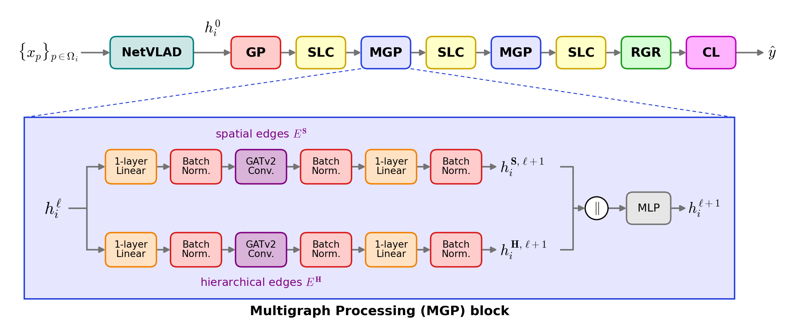

# SLC-HELM: Single-Link Clustering Hierarchical Lightweight Multigraph Network

Code of the paper **"Single-Link Clustering Hierarchical Lightweight Multigraph Network"** (under review), by
João Pedro O. Batisteli, Yukiko Kenmochi, Sébastien Bougleux, Olivier Lézoray, Silvio Jamil F. Guimarães and
Zenilton K. G. Patrocínio Jr. (IMSCIENCE, PUC Minas, Brazil, and Univ Caen Normandie, ENSICAEN, CNRS, GREYC, France).

Hierarchical multigraphs help graph neural networks capture local and global image dependencies, but building them
for every image before training is expensive. **SLC-HELM builds the hierarchy during training**: starting from the
Region Adjacency Graph (RAG) of the superpixels of an image, Single-Link Clustering (SLC) pooling layers coarsen the
most recent scale and *add* the result as a new scale, without discarding the existing nodes. Spatial and
hierarchical relations are processed by separate attention (GATv2) branches. With only four scales and fewer than one
million parameters, SLC-HELM outperforms its precomputed-hierarchy counterpart (mHELMNet) on EuroSAT and RESISC45,
and on EuroSAT it comes within 1.2 percentage points of Transformer-based foundation models that have 70 to 400 times
more parameters.

<p align="center">
  
</p>

<p align="center"><em>SLC-HELM: a graph processing (GP) module on the base graph, three SLC pooling steps interleaved
with multigraph processing (MGP) blocks, a region graph readout (RGR) and a classification layer (CL). Bottom: the MGP
block, with independent branches for the spatial and hierarchical edges.</em></p>

## Contents

- [Method](#method)
- [Results](#results)
- [Repository structure](#repository-structure)
- [Installation](#installation)
- [Datasets](#datasets)
- [Reproducing the paper](#reproducing-the-paper)
- [Hyperparameters](#hyperparameters)
- [Hyperparameter search](#hyperparameter-search)
- [CNN baseline (MobileNetV3-Small)](#cnn-baseline-mobilenetv3-small)
- [Compute and storage](#compute-and-storage)
- [Citation](#citation)

## Method

**Graph construction.** Each image is over-segmented with [DISF](https://github.com/LIDS-UNICAMP/DISF); every
superpixel is a node, and two superpixels sharing a boundary (8-connectivity) are linked by a spatial edge. This RAG is
the first scale of the hierarchy. Only the superpixel map and the edges are computed offline.

**Node features.** Dense 64-d pixel descriptors come from the first two convolutional layers of a frozen,
ImageNet-pretrained VGG16 (cut before the first max-pooling, so at full resolution). A NetVLAD layer with *K* learnable
centroids aggregates the descriptors of each superpixel, without ℓ2 normalization, and a two-layer perceptron (256
hidden units) with batch normalization projects them to *d* dimensions. The node feature is the concatenation of this
embedding, the mean RGB color and the mean normalized position of the superpixel (*d* + 5). NetVLAD and the projection
are trained end-to-end with the classification loss; only VGG16 stays frozen.

**SLC pooling.** At each hierarchy-expansion step, the Euclidean feature distance is computed along the spatial
edges of the newest scale. Edges whose distance is at most the *p*-th percentile of the edge distances (over the batch
or over each graph) are kept, and the connected components of the kept edges become the nodes of a coarser graph,
represented by the mean of their features. The coarser graph inherits the spatial edges between different clusters,
and hierarchical edges link every node to its parent. The pooled scale is *appended* to the multigraph: after three
steps it holds four scales. SLC has no parameters and is not differentiable, but the partition is recomputed at every
forward pass from features produced by trainable layers, so the hierarchy adapts to the task during training.

**Multigraph processing.** The GP module (three stacked GATv2 convolutions with a residual connection) works on the
base graph. Each MGP block runs one GATv2 branch on the spatial edges and another on the hierarchical edges, and fuses
their outputs with an MLP. The RGR sums the node features of each scale and weights the scales with a softmax over
their log-sum-exp scores; the CL (two linear layers) gives the class scores.

## Results

Average test accuracy (%) over five seeds (1, 16, 20, 58, 123), from Table 1 of the paper. † trained and evaluated
under the same protocol (fixed 60%/20%/20% train/validation/test split); \* hybrid models, whose graph nodes are
patches of CNN or Transformer feature maps; "—" not reported. The other methods report no standard deviation, and on
RESISC45 and AID most of them use 20% of the images for training and 80% for test, without a validation set, so the
comparison on these two datasets must be read with care.

| Method | # params | EuroSAT | RESISC45 | AID |
|---|---:|---:|---:|---:|
| **GNN approaches** | | | | |
| **SLC-HELM† (ours)** | 0.77M–0.97M | **98.04 ± 0.13** | **93.21 ± 0.22** | **94.19 ± 0.36** |
| mHELMNet† | 0.48M | 96.93 ± 0.40 | 86.95 ± 0.70 | — |
| DFAGCN\* | — | — | 89.21 | 94.88 |
| HGTNet\* | 68.5M | — | 95.75 ± 0.10 | 96.91 ± 0.14 |
| **CNN approaches** | | | | |
| MobileNetV3-Small† (from scratch) | 1.5M | 96.56 ± 0.24 | 92.89 ± 0.36 | — |
| GASSL | 25.6M | 96.38 | 93.06 | 93.55 |
| CACo | 25.6M | 97.77 | 91.94 | 90.88 |
| SeCo | 25.6M | 97.34 | 92.91 | 93.47 |
| **Transformer approaches** | | | | |
| GFM | 87.7M | — | 94.64 | 95.47 |
| Scale-MAE | 307M | 98.59 | 95.04 | 96.44 |
| SatMAE | 307M | 95.74 | 94.10 | 95.02 |
| μ2Net+ | 68.7M | 99.22 | 97.21 | — |

Trainable parameters of SLC-HELM: 767,770 (EuroSAT), 970,173 (RESISC45) and 830,374 (AID); they differ in the number
of classes, attention heads and NetVLAD clusters (see [Hyperparameters](#hyperparameters)).

## Repository structure

Each dataset has a self-contained folder with the same pipeline; `model.py` is identical in the three.

```
SLC-HELM/
├── assets/                      figures of this README (make_architecture_figure.py draws the architecture)
├── requirements.txt             training / test / search environment
├── requirements-build.txt       graph-building environment (DISF)
├── eurosat/                     EuroSAT (64×64, 10 classes)
├── resisc45/                    NWPU-RESISC45 (256×256, 45 classes)
└── aid/                         AID (600×600, 30 classes)
    ├── config.py                paths, image size, number of superpixels, DISF seeds, splits, class names
    ├── augmentations.py         the 51 training augmentations (seeded per image and augmentation)
    ├── superpixels.py           DISF segmentation and 8-connected RAG
    ├── prepare_images.py        decodes the images once into uint8 arrays (RESISC45, AID)
    ├── build_dataset.py/.sh     offline generation of the superpixel graphs (resumable)
    ├── check_dataset.py         checks the graphs in the training environment (RESISC45, AID)
    ├── dataset.py               graph datasets (image + pixel-to-superpixel map + edges)
    ├── model.py                 PixelEncoder, NetVLAD, SuperpixelEncoder, SingleLinkPooling, SCH_HELM2 (= SLC-HELM)
    ├── train.py / test.py       training (MLflow, early stopping, resumable snapshots) and evaluation
    ├── train_runs.sh / test_runs.sh          the five seeds in sequence
    ├── run_experiment.sh / run_parallel.sh   five seeds, train + test, in sequence or one per GPU (RESISC45, AID)
    ├── search_config.py, search_build.py, search.py, run_search.sh   hyperparameter search with Optuna
    ├── cnn_baseline.py / run_cnn_baseline.sh  MobileNetV3-Small baseline on the same images and augmentations
    ├── configs/                 hyperparameter configurations (JSON) and search results (CSV)
    └── indices/ or splits/      the fixed train/validation/test splits
```

In the code the model is called `SCH_HELM2`. `split_protocol.py` (RESISC45, AID) defines other train/test protocols
over the same graphs (e.g. 20%/80% on RESISC45, 50%/50% on AID); they are not used in the paper.

## Installation

Two Python environments are used, because the DISF bindings need NumPy 1.x:

```bash
# 1. Graph building (DISF), Python 3.10
conda create -n slc-helm-build python=3.10 && conda activate slc-helm-build
pip install -r requirements-build.txt
# then build and install the DISF Python bindings from https://github.com/LIDS-UNICAMP/DISF in this environment

# 2. Training, test and hyperparameter search, Python 3.12 (pip only)
python3.12 -m venv ~/venvs/slc-helm && source ~/venvs/slc-helm/bin/activate
pip install --upgrade pip && pip install -r requirements.txt
```

The shell scripts take the interpreters from `BUILD_PYTHON` (graph building) and `PYTHON` / `TRAIN_PYTHON`
(training); both default to `python`. The VGG16 ImageNet weights are downloaded by torchvision on first use (offline:
copy them to `~/.cache/torch/hub/checkpoints/vgg16-397923af.pth`). Experiments are logged with MLflow; set
`MLFLOW_TRACKING_URI=file:$PWD/mlruns` to use a local file store instead of a server at `http://127.0.0.1:5000`.

Keep the pinned versions of torchvision, NumPy, Pillow and OpenCV. To save disk, RESISC45 and AID store only the
superpixel maps and rebuild the augmented images when a graph is loaded, so the training environment must reproduce
the images the maps were built from (`check_dataset.py` verifies their MD5).

## Datasets

All runs use a fixed 60%/20%/20% train/validation/test split, included in the repository.

| Dataset | Images | Size | Classes | Train / val / test | Source |
|---|---:|---|---:|---|---|
| EuroSAT (RGB) | 27,000 | 64×64 | 10 | 16,200 / 5,400 / 5,400 | torchvision `EuroSAT`; split in `eurosat/indices/` |
| NWPU-RESISC45 | 31,500 | 256×256 | 45 | 18,900 / 6,300 / 6,300 | torchgeo `RESISC45` splits |
| AID | 10,000 | 600×600 | 30 | 6,000 / 2,000 / 2,000 | [isaaccorley/aid](https://huggingface.co/datasets/isaaccorley/aid) (torchgeo-bench split, seed 0); split in `aid/splits/` |

```bash
# EuroSAT: torchvision downloads it to eurosat/data/raw/eurosat/2750/<class>/*.jpg
cd eurosat && python -c "from torchvision.datasets import EuroSAT; EuroSAT('data/raw', download=True)"

# RESISC45: downloads the torchgeo splits and exports them to resisc45/data/raw/{split}/ (needs pip install torchgeo)
cd resisc45 && python export_raw.py

# AID: the original images, rehosted on Hugging Face, extracted to aid/data/raw/AID/<Class>/*.jpg
cd aid && mkdir -p data/raw && cd data/raw
curl -L -O https://huggingface.co/datasets/isaaccorley/aid/resolve/main/AID.zip
echo "79345ef1766e85f7b92cf556c809c4f32ff24228ae71aadf96780f74f48c26a4  AID.zip" | sha256sum -c
unzip -q AID.zip
```

## Reproducing the paper

Each training image gets 51 augmented versions (rotations, flips, blur, noise, color changes, occlusions, perspective
and affine transforms, and versions with other numbers of superpixels), each with its own superpixel graph; every
epoch goes through all of them. Five seeds are trained (1, 16, 20, 58, 123) and the checkpoint with the best
validation accuracy of each is evaluated on the test set.

**EuroSAT** (configuration of the paper = the defaults of `train.py`, 50 superpixels):

```bash
cd eurosat
BUILD_PYTHON=/path/to/build-env/python bash build_dataset.sh   # 826,200 train + 10,800 val/test graphs
export MLFLOW_TRACKING_URI=file:$PWD/mlruns
bash train_runs.sh && bash test_runs.sh                        # seeds 1 123 16 20 58
```

**RESISC45** (`configs/trial_53.json`, 300 superpixels):

```bash
cd resisc45
NODES=300 BUILD_PYTHON=/path/to/build-env/python TRAIN_PYTHON=python bash build_dataset.sh   # data/processed_n300
CONFIG=trial_53 bash run_experiment.sh netvlad lse        # five seeds in sequence, train then test
CONFIG=trial_53 bash run_parallel.sh netvlad lse          # or one seed per GPU (GPUS="0 1 2 3 4"), in the background
```

**AID** (`configs/aid_trial_33.json`, 300 superpixels):

```bash
cd aid
NODES=300 BUILD_PYTHON=/path/to/build-env/python TRAIN_PYTHON=python bash build_dataset.sh
CONFIG=aid_trial_33 bash run_experiment.sh netvlad lse    # or run_parallel.sh
```

A single run is `python train.py --seed 1 --config configs/trial_53.json`, followed by `python test.py` with the same
arguments (`python train.py --help` lists all options; explicit arguments override the configuration file). The run
scripts check the dataset once, skip finished seeds and resume interrupted trainings from their snapshot. Outputs:
`weights/` (checkpoints), `logs/` (training and test logs; the test log ends with the accuracy, per-class accuracies
and inference time), `*_confusion_matrix.png` and the MLflow experiment.

## Hyperparameters

### Configurations of the paper

| | EuroSAT | RESISC45 | AID |
|---|---|---|---|
| Configuration | `train.py` defaults (`configs/default.json`) | `configs/trial_53.json` | `configs/aid_trial_33.json` |
| Superpixels (DISF target, `n_nodes`) | 50 | 300 | 300 |
| DISF initial seeds | 1,000 | 5,000 | 5,000 |
| NetVLAD clusters *K* (`num_clusters`) | 16 | 16 | 8 |
| Embedding size *d* (`embedding_size`) | 64 | 64 | 64 |
| GATv2 attention heads (`heads`) | 2 | 4 | 4 |
| SLC percentile *p* (`percentile`) | 50 | 35 | 75 |
| SLC threshold over (`threshold`) | batch | batch | graph |
| Dropout (`dropout`) | 0.1 | 0.1 | 0.0 |
| Learning rate (`lr`) | 1.0e-3 | 4.11e-4 | 5.48e-4 |
| Weight decay (`weight_decay`) | 3.0e-6 | 6.27e-7 | 6.94e-7 |
| Label smoothing (`label_smoothing`) | 0.1 | 0.2 | 0.2 |
| Batch size | 64 | 64 | 32 |
| Trainable parameters | 767,770 | 970,173 | 830,374 |

`percentile` is the share of the edges of the newest scale that SLC keeps (and merges along): with `threshold=batch`
the percentile is taken over all edges of the batch, with `threshold=graph` over the edges of each graph, so that the
clusters of an image do not depend on the other images of its batch.

### Settings shared by all datasets

| Setting | Value |
|---|---|
| Pixel encoder | VGG16 `conv1_1`–`relu1_2`, ImageNet weights, frozen (64-d per pixel, full resolution) |
| NetVLAD | no ℓ2 normalization; projection MLP 64·*K* → 256 → *d* with batch normalization |
| Node features | [embedding ‖ mean RGB ‖ mean (x, y)] → linear → *d* |
| Scales | 4 (base RAG + 3 SLC poolings), Euclidean feature distance |
| GP / MGP | GATv2 blocks with linear layers, batch norm and residual connection; 3 convolutions on spatial edges, 1 on hierarchical edges; MGP fusion MLP with 256 hidden units |
| Readout (RGR) | linear *d* → 256, graph size normalization, sum per scale, softmax over the log-sum-exp scores of the scales (`--readout lse`) |
| Classifier (CL) | 256 → 512 → classes |
| Optimizer | Adam, β = (0.9, 0.98), ε = 1e-9 |
| LR schedule | ReduceLROnPlateau on validation accuracy, factor 0.5, patience 10, minimum 1e-6 |
| Early stopping | patience 30 epochs on validation accuracy, at most 300 epochs |
| Loss | cross-entropy with label smoothing |
| Augmentation | 51 graphs per training image, all used in every epoch |
| Seeds | 1, 16, 20, 58, 123 |

## Hyperparameter search

The configurations were selected with [Optuna](https://optuna.org) without looking at the test set. The protocol is
the same for the three datasets (`search.py`, whole sequence in `run_search.sh`):

1. **Graphs** (`search_build.py`, graph-building environment): the superpixel maps of every count under test, for the
   whole validation set and a stratified 10% of the training images, with 8 of the augmentations (identity,
   rotations by 90° and 270°, Gaussian blur, color jitter, occlusion, affine transform, horizontal flip).
2. **Search** (`search.py run`): 60 trials of up to 30 epochs on that subset (ReduceLROnPlateau patience 5, early
   stopping patience 10), seed 1, maximizing the validation accuracy. Multivariate TPE sampler (15 random startup
   trials) and Hyperband pruner (5 to 30 epochs, reduction factor 3). A reference configuration is enqueued as the
   first trial. On AID, trials that exceeded the 24 GB of GPU memory were pruned and not counted.
3. **Confirmation** (`search.py top` and `search.py confirm`): the 3 best trials and the reference are trained again
   with 5 new seeds (2 to 6) on 30% of the training images; the configuration with the highest mean validation
   accuracy is kept. Picking the best of many single-seed trials inflates its score, so only this step compares
   configurations.

### Search space

| Hyperparameter | Values |
|---|---|
| `n_nodes` (superpixels) | EuroSAT: 25, 35, 50, 75, 100, 150 · RESISC45: 50, 100, 150, 200, 300 · AID: 300, 450, 650, 950, 1400 |
| `percentile` | 20 to 80, step 5 |
| `threshold` | batch, graph |
| `lr` | 1e-4 to 3e-3 (log scale) |
| `dropout` | 0 to 0.4, step 0.05 |
| `heads` | 1, 2, 4 |
| `embedding_size` | 32, 64, 128 (AID: 32, 64; 128 does not fit in 24 GB with many superpixels) |
| `num_clusters` (*K*) | 8, 16, 32 |
| `label_smoothing` | 0 to 0.2, step 0.05 |
| `weight_decay` | 1e-7 to 1e-4 (log scale) |

The superpixel counts scale with the image size: on EuroSAT they are centered on 50 and spaced by ratios of 1.3 to
1.5 (superpixels of ~160 down to ~27 pixels); on AID, 1,400 superpixels of a 600×600 image have about the size of 300
superpixels of a 256×256 RESISC45 image. The reference configurations are `configs/default.json` on EuroSAT (the
configuration of the paper), the defaults of `train.py` on RESISC45 (100 superpixels) and the RESISC45 winner
`trial_53` on AID.

### Running a search

```bash
cd eurosat        # or resisc45, aid
mkdir -p logs/search
BUILD_PYTHON=/path/to/build-env/python PYTHON=python nohup setsid bash run_search.sh >> logs/search/run.out 2>&1 < /dev/null &
```

`run_search.sh` is resumable: the study is stored in `logs/search/study.db` and running the script again continues it.
The results are written to `logs/search/trials.csv` (all trials), `logs/search/confirm_configs.json` (the confirmed
configurations) and `logs/search/confirm.csv` (validation accuracy per configuration and seed), and logged to MLflow.
On EuroSAT, `python search.py export trial_<n>` writes a confirmed configuration to `configs/trial_<n>.json`, to be
used with `python train.py --config configs/trial_<n>.json`.

### Search results

Validation accuracy (%) of the confirmation, over seeds 2–6, on 30% of the training images with 8 augmentations and
30 epochs (not the full protocol), with the paired difference to the reference. The 60 trials are in
`resisc45/configs/search_trials.csv` and `aid/configs/search_trials.csv`, the confirmations in `search_confirm.csv`.

**RESISC45** (28 trials completed, 32 pruned):

| Configuration | Superpixels | Percentile | lr | Dropout | Heads | Label smoothing | Weight decay | Val. accuracy | Difference (pp) |
|---|---:|---:|---:|---:|---:|---:|---:|---:|---|
| **`trial_53`** (selected) | 300 | 35 | 4.1e-4 | 0.10 | 4 | 0.2 | 6.3e-7 | **82.30 ± 0.65** | +2.46 ± 0.95 (better in 5/5 seeds) |
| `trial_55` | 300 | 35 | 3.5e-4 | 0.15 | 4 | 0.2 | 1.8e-5 | 81.43 ± 0.41 | +1.59 ± 1.12 (5/5) |
| `trial_49` | 300 | 30 | 4.9e-4 | 0.15 | 4 | 0.2 | 2.6e-6 | 80.72 ± 0.26 | +0.89 ± 1.37 (3/5) |
| reference (`train.py` defaults) | 100 | 50 | 1.0e-3 | 0.10 | 2 | 0.1 | 3.0e-6 | 79.83 ± 1.16 | — |
| `trial_19` | 100 | 20 | 1.1e-3 | 0.10 | 2 | 0.1 | 1.2e-5 | 78.67 ± 0.75 | −1.17 ± 1.11 (1/5) |

All RESISC45 configurations above use the batch threshold, *d* = 64 and *K* = 16. `trial_19`, the best trial with 100
superpixels, was added to the confirmation afterwards.

**AID** (17 trials completed, 43 pruned; the sampler concentrated on 300 and 950 superpixels):

| Configuration | Superpixels | Val. accuracy | Difference (pp) |
|---|---:|---:|---|
| **`trial_33`** (selected, `configs/aid_trial_33.json`) | 300 | **82.55 ± 0.42** | +1.06 ± 0.92 (better in 4/5 seeds) |
| reference (RESISC45 `trial_53`, `configs/trial_53.json`) | 300 | 81.49 ± 0.69 | — |
| `trial_28` | 950 | 81.44 ± 1.41 | −0.05 ± 2.03 (2/5) |
| `trial_2` | 300 | 80.19 ± 0.91 | −1.30 ± 1.04 (0/5) |

## CNN baseline (MobileNetV3-Small)

`cnn_baseline.py` trains torchvision's MobileNetV3-Small (1.0×, 1.5M parameters) from scratch on the same images,
splits and 51 augmentations as SLC-HELM, with the same optimizer, schedule and early stopping, batch size 64 and the
images at their original size. On RESISC45 and AID the learning rate, weight decay and label smoothing come from the
selected SLC-HELM configuration (`--config`).

```bash
bash run_cnn_baseline.sh                     # seeds 1 16 20 58 123, in the background
python cnn_baseline.py --seed 1              # a single run in the foreground
```

## Compute and storage

Approximate figures on one NVIDIA RTX 3090 (24 GB) with 12 CPU threads.

| | EuroSAT (50 sp.) | RESISC45 (300 sp.) | AID (300 sp.) |
|---|---|---|---|
| Training graphs per epoch | 826,200 | 963,900 | 306,000 |
| Stored graphs | ~23 GB (images included) | ~20 GB of maps + 5.8 GB of decoded images | ~18 GB of maps + 10.8 GB of decoded images |
| Graph building (12 workers) | ~30 min | ~9 h (100 sp.) | ~21 h |
| Training epoch | ~16 min | ~55 min | ~45–55 min |

Data loading rebuilds augmented images on the CPU: keep about 8 loader workers per run (`WORKERS`) and
seeds × (workers + 3) below the number of CPU cores when several seeds share a machine.

## Citation

The paper is currently under review. The citation (BibTeX) will be added here once it is published.

Related work by the authors: *Hierarchical Multiscale Representation in Remote Sensing Scene Classification*
(mHELMNet, IEEE GRSL, 2025) and *Hierarchical layered multigraph network with scale importance estimation for image
classification* (Applied Soft Computing, 2025). The superpixel features follow O. Lézoray, *Learning to merge
superpixels* (EANN 2026).
